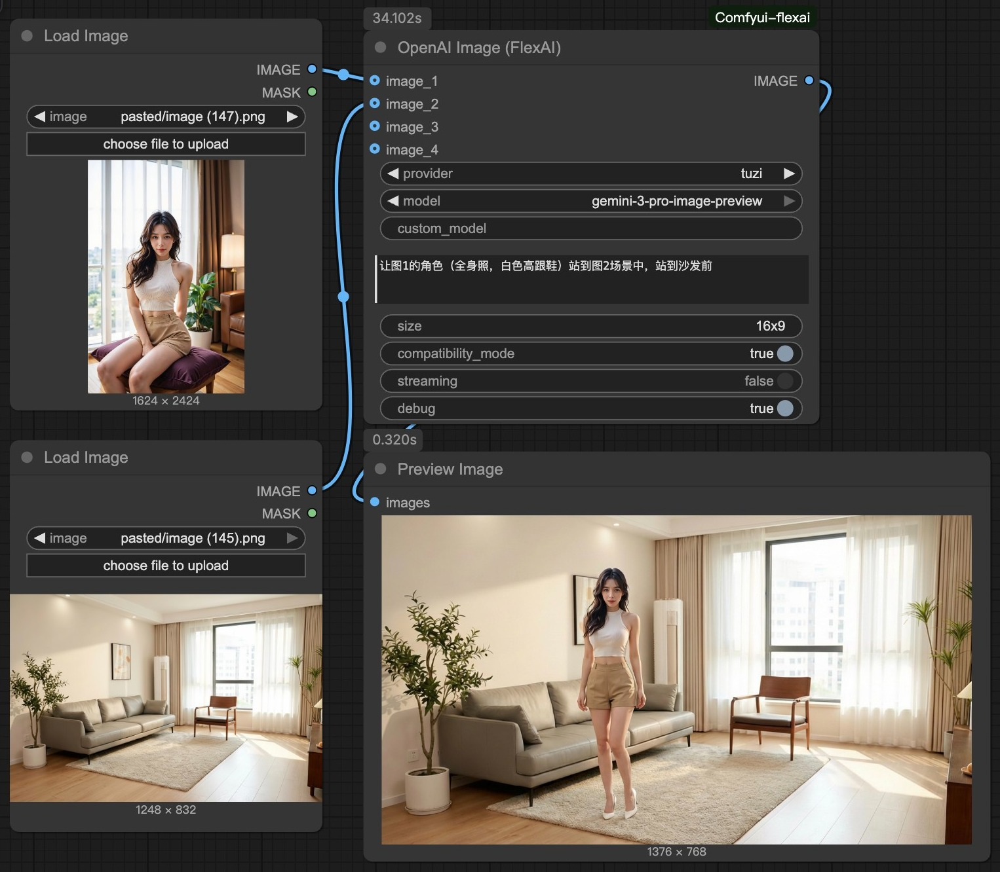
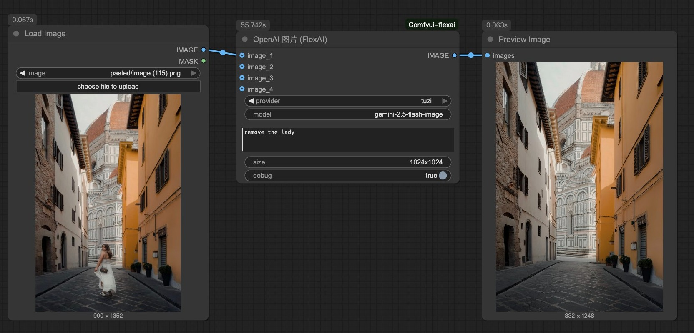
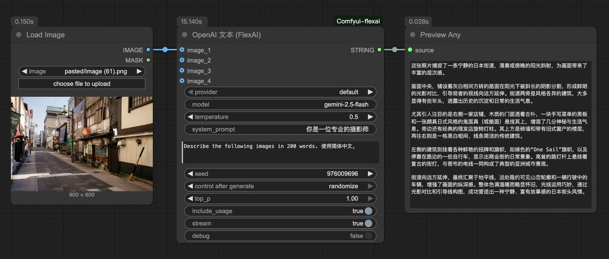
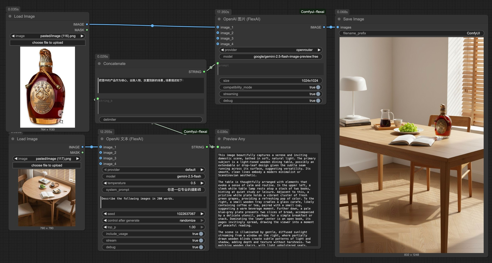
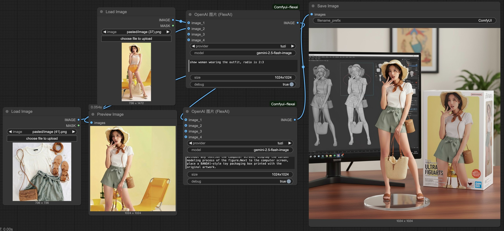

<!-- 双语链接 -->
[English](README.md) | 中文 / Chinese

# ComfyUI FlexAI 插件

[](https://github.com/Semonxue/Comfyui-flexai)
[](LICENSE)

现代化的统一 ComfyUI 插件，支持 OpenAI 兼容 API，具备增强调试能力，以及文本、图像、视频三类多用途节点。

写这个插件主要为了简化自己的工作，通过标准化的openai接口就可是接入llm或图片生成，最近用这个节点主要在玩 gemini-2.5-flash-image 的生成（没测过gemini官方接口，我接的是openai兼容端点），效果还不错。

## 最近更新
- 2026-10-30 1.3.0 **Seedance 2.0 及以上全量对齐**：按模型家族（2.0 / 2.0 Fast / 2.0 Mini / 2.5）自动套用协议规则——分辨率档位与 `SUPER_*` 超分按家族校验并大写发送；`duration` 超出范围自动收敛（2.0 系列 4~15s、2.5 4~30s）；2.5 的单图/首尾帧自动把 `ratio` 置为 `adaptive`；新增 `output_format`（2.5 的 mp4/mov）、`reference_video`（URL/`asset://`，2.5 单视频自动 `videoExtend`）、`reference_audio`（URL/`asset://`/mp3-wav data URI），`content[]` 现在可混合 图片 + 视频 + 音频 三类参考素材。1.0/1.5 不再专门适配（走宽松兼容逻辑）。
- 2026-10-30 1.2.0 **支持多参考图 / 多主体参考（Seedance 语义）**：节点新增 `image_2` / `image_3` / `image_4` 三个图像槽与 `reference_mode`，按 Seedance 的 `content[]` + `role` 规则发送：1 张图→`imageToVideo`（role `first_frame`），首帧+尾帧→`firstAndLastFrame`（`first_frame` / `last_frame`），2 张及以上→`referToVideo`（全部 role `reference_image`），并显式带上 `refer_model`。参考图**不会**被拉伸到输出尺寸（只有首/尾帧会按档位预缩放），超过 6000px 的长边会自动缩小到 Seedance 限制内。单图仍保留 `input_reference` / multipart 兼容回退。
- 2026-10-30 1.1.1 **视频尺寸改为「分辨率档位 + 画幅比例」**：视频模型并不按像素出图（tu-zi / 火山 Seedance 的请求体是 `{"resolution":"720p","ratio":"16:9","duration":8}`），旧版发 `size` 像素对会被网关忽略、导致无论选什么都输出默认尺寸。现改为 `ratio`（16:9/9:16/1:1/4:3/3:4/21:9/adaptive）+ `resolution`（480p/720p/1080p/4k）+ `duration`（整数秒）+ `generate_audio` / `watermark`；`size` 仅在显式填写 `custom_size` 或使用 Sora 系模型时作为兼容字段发送。同时按「完整扁平参数 → 大写分辨率 → Seedance 原生 `content[]` → 最小 OpenAI 体 → multipart」逐级降级，图片依次尝试 JSON `input_reference`(data URI) / `content[]` 图片项 / multipart 上传。
- 2026-10-30 1.1.0 **新增视频节点**：`flexai:openai_video`，走 `/v1/videos`（Sora 2 风格）协议，支持文生视频与首帧图生视频，异步轮询任务并下载 MP4，直接输出 ComfyUI 原生 `VIDEO`（可接 `SaveVideo` / `Get Video Components`）。<br>同时 **清理过时模型**：`dall-e-3`、`dall-e-2`、`gpt-4-turbo`、`gpt-3.5-turbo` 已从默认值与模型列表中移除，默认图像模型改为 `gpt-image-2.5` 系列，默认文本模型改为 `gpt-4o`。<br>⚠️ OpenAI 官方托管 Videos API 已于 2026-09-24 下线，视频节点主要面向 **OpenAI 兼容代理**（new-api / tu-zi 等）。
- 2026-9-7 **画幅比例标注**：图片节点的所有尺寸预设现在都包含直观的画幅比例标注，例如 `1254x1254(1:1,1K)`、`1024x1536(2:3,1K)`、`1672x941(16:9,1K)`。
- 2025-11-21 1.0.7 **支持新模型与尺寸比例**：为图像节点添加了对 `nano-banana`、`nano-banana-pro` 等模型的支持，并允许在非兼容模式下使用宽高比设置尺寸。

- 2025-9-13 1.0.6 图片节点接收图像uri内容时支持jpg类型，以支持部分seedream4的接口请求。
- 2025-9-3 1.0.5 **新增模型记忆功能**：为图像和文本节点提供独立的模型记忆功能，并对代码结构进行了重构优化。
- 2025-9-3 1.0.4 **实现多图返回**：图像节点现在可以一次性处理和输出多张图片，并解决了在此过程中出现的尺寸不匹配和数据类型错误。
- 2025-9-3 1.0.3 修复了流式响应处理中的一个错误，并改进了调试日志记录。
- 2025-9-3 1.0.2 加入对openrouter的支持（支持流式），debug信息单独合并到debug.log
- 2025-9-2 1.0.1 优化debug模式下的出错提示，加入对openrouter上的免费模型的支持
- 2025-9-2 1.0发布,亲测接入[tuzi](https://api.tu-zi.com/)和[GB](https://github.com/snailyp/gemini-balance)一点没毛病
- 2025-8-31 插件初始化  

## ✨ 核心特性

### 🌐 多API来源支持
- **灵活配置**：通过 `.env` 文件支持多个 API 提供商，这样如果有多个token的渠道就不用切来切去了，可以共用。
- **动态切换**：无需重启 ComfyUI 即可切换提供商
- **模型记忆与管理**: 可通过下拉菜单选择常用模型，或在 `custom_model` 输入框中填入新模型，**运行一次后**即可自动保存并供未来选用。

### 🖼️ OpenAI 图片节点 (`flexai:openai_image`)

**双模式运行：**
- **编辑模式**：提供 1-4 张图片 → 使用 `images.edit` API ，即 `/v1/images/edits` 接口
- **生成模式**：无图片输入 → 使用 `images.generate` API，即 `/v1/images/generations` 接口

**兼容模式**：通过chat端点实现图像生成，兼容OpenRouter等第三方Openai兼容接口，流式支持,即常规的 `/v1/chat/completions` 接口

**模型支持扩展**：
- 目前接口已支持 `nano-banana`、`nano-banana-pro` 等新模型。
- 您可以通过 `custom_model` 字段直接调用，例如，在使用 `api.tu-zi.com` 服务时，可以填入 `gemini-3-pro-image-preview` 来使用。
- 这些模型同时支持标准的生图模式和兼容模式。

### 🎬 OpenAI 视频节点 (`flexai:openai_video`)

OpenAI 兼容网关通用的视频节点（`/v1/videos`，如 tu-zi、new-api 等），输出 ComfyUI 原生 **`VIDEO`**，可直接接 `SaveVideo`、`Get Video Components`（不落地成帧张量，长视频不爆内存）。目前已针对 **Seedance 2.0 / 2.0 Fast / 2.0 Mini / 2.5** 做了家族级参数适配；其它视频模型走宽松参数路径（见下方「兼容性」）。

**五种生成模式**（图片角色由 `reference_mode` 决定，`auto` 时按接入数量自动推断）：

| 模式 | 接入方式 | 发送的 `refer_model` | `content[]` 里的 role |
|------|----------|----------------------|------------------------|
| 文生视频 | 不接图 | `textToVideo` | — |
| 图生视频（首帧） | 1 张图 | `imageToVideo` | `first_frame` |
| 首尾帧 | 2 张图 + `first_last_frame` | `firstAndLastFrame` | `first_frame` + `last_frame` |
| 多主体参考 | 2–4 张图 | `referToVideo` | `reference_image` |
| 视频延展（仅 2.5） | 只接 1 段 `reference_video` | `videoExtend` | `reference_video` |

**按模型家族自动套协议**（分辨率档位、时长范围、特殊规则都随家族切换）：

| 家族 | `resolution` | `duration` | 特殊规则 |
|------|--------------|------------|----------|
| Seedance 2.0 | `480P` `720P` `1080P` `4K` `SUPER_720P/1080P/4K` | 4–15s | 支持 `super_*` 超分 |
| Seedance 2.0 Fast / Mini | `480P` `720P` `SUPER_720P/1080P/4K` | 4–15s | **不支持** `1080P`/`4K` 原生档位 |
| Seedance 2.5 | `480P` `720P` `1080P` | 4–30s | 首帧/首尾帧自动 `ratio=adaptive`；`output_format` 支持 `mp4`/`mov`；支持视频延展 |

**几何模型**：视频输出不是像素概念，而是 `resolution`（档位，短边=档位数字）+ `ratio`（画幅，含 `adaptive`）+ `duration`（整数秒）。节点按家族校验后以大写发送（`720P`/`SUPER_4K`…），时长超出范围自动收敛；像素 `size` 仅作为 Sora 等旧渠道的兼容字段（填了 `custom_size` 或模型名含 `sora` 才发送）。

**参考素材**：`content[]` 可混用 图片（最多 4 张）+ 视频（`reference_video`，URL 或 `asset://`）+ 音频（`reference_audio`，URL / `asset://` / mp3-wav data URI），图片按首帧、尾帧、参考主体分别打 `role`；2.5 单帧走 `adaptive` 时不会把首帧裁成固定比例。

**异步任务处理**：创建 → 轮询 `GET /v1/videos/{id}`（`status`/`progress`）→ 完成后读取 `video_url` 或 `GET /v1/videos/{id}/content` 下载 MP4 → 返回 `VIDEO`。

**兼容性**：
- 请求体依次尝试：完整扁平参数 → `resolution` 大写变体 → Seedance 原生 `content[]` → 最小 OpenAI 体 → multipart（遇 401/403/404/429 立即停止）；
- 参考图依次尝试：`content[]`（首选）→ 顶层 `input_reference`（data URI）→ multipart 上传（仅单图）；
- 兼容 `{"code":0,"data":{...}}` 包装响应、直接返回 URL 的代理，并遵守服务端 `openai-poll-after-ms` 轮询提示；
- ⚠️ OpenAI 官方托管 Videos API 已于 2026-09-24 下线，节点面向 **OpenAI 兼容代理渠道**（tu-zi / 火山 Seedance 系）。

**暂不支持**：Seedance 2.5 Draft 两步流程（`draft` / `draft_task`）、真人素材库上传与审核（可手填 `asset://` 到视频/音频参考）、`count>1` 与 `seed`（网关 `/v1/videos` 未暴露）。

### 💬 OpenAI 文本节点 (`flexai:openai_text`)
**多模态支持：**
- **纯文本模式**：标准文本生成
- **视觉模式**：支持图片输入进行视觉问答
- **混合模式**：文本+图片结合分析


**多模态文本生成：**
- 纯文本或视觉语言理解
- 支持 1-4 张参考图片，自动缩放
- 流式和非流式模式
- **调试模式**：所有操作的完整 JSON 日志记录

## 快速开始

### 安装

1. 克隆到 ComfyUI 自定义节点目录：
   ```bash
   cd ComfyUI/custom_nodes
   git clone https://github.com/Semonxue/Comfyui-flexai.git
   ```

2. 安装依赖：
   ```bash
   cd Comfyui-flexai
   pip install -r requirements.txt
   ```

3. 配置提供商（见配置章节）
4. 重启 ComfyUI

## 配置

在插件根目录创建 `.env` 文件,或复制 `.env.example` 文件并重命名。

### 单一提供商
```bash
OPENAI_API_KEY=your_openai_api_key_here
OPENAI_API_BASE=https://api.openai.com/v1  # 可选
```

### 多提供商（推荐）
```bash
# 定义提供商列表
OPENAI_PROVIDERS=openai,anthropic,custom

# OpenAI
OPENAI_API_KEY_openai=sk-your-openai-key
OPENAI_API_BASE_openai=https://api.openai.com/v1

# Anthropic（通过 OpenAI 兼容端点）
OPENAI_API_KEY_anthropic=sk-your-anthropic-key  
OPENAI_API_BASE_anthropic=https://api.anthropic.com/v1

# 自定义端点
OPENAI_API_KEY_custom=your-custom-key
OPENAI_API_BASE_custom=https://your-api.example.com/v1
```


## 节点参数

### 图片节点 (`flexai:openai_image`)

| 参数 | 类型 | 描述 |
|------|------|------|
| `provider` | 选择 | API 提供商选择 |
| `model` | 选择 | 模型名称 (下拉来自 `flexai_models.json`，如 `gpt-image-2.5`, `nano-banana-pro`) |
| `custom_model` | 字符串 | 临时改用其它模型，运行一次后自动写入模型列表 |
| `prompt` | 字符串 | 生成/编辑提示词 |
| `image_1-4` | 图片 | 可选图片（提供任意张则进入编辑模式） |
| `size` | 选择/字符串 | 带画幅比例标注的尺寸预设（如 `1254x1254(1:1,1K)`、`1024x1536(2:3,1K)`、`1672x941(16:9,1K)`）。下拉菜单涵盖所有常见比例，每个比例分 1K/2K/4K 三档。自由输入请用 `custom_size` 参数。<br><br> **宽高比支持**：对于 `nano-banana` 和 `nano-banana-pro` 等特定模型，在**非兼容模式**下，此字段可以直接输入宽高比。支持的比例与对应的分辨率如下：<br> `1x1` → `1024x1024` <br> `2x3` → `832x1248` <br> `3x2` → `1248x832` <br> `3x4` → `864x1184` <br> `4x3` → `1184x864` <br> `4x5` → `896x1152` <br> `5x4` → `1152x896` <br> `9x16` → `768x1344` <br> `16x9` → `1344x768` <br> `21x9` → `1536x672` |
| `compatibility_mode` | 布尔 | **兼容模式**：启用后通过chat端点实现图像生成，兼容OpenRouter等第三方服务 |
| `streaming` | 布尔 | 兼容模式下启用流式 |
| `debug` | 布尔 | **启用详细调试日志** |

### 视频节点 (`flexai:openai_video`)

| 参数 | 类型 | 描述 |
|------|------|------|
| `provider` | 选择 | API 提供商选择 |
| `model` | 选择 | 视频模型（默认优先选中列表里的 Seedance 2.x 型号；其它模型可在 `custom_model` 里填，运行一次后自动记住） |
| `custom_model` | 字符串 | 临时改用其它模型，运行一次后自动写入模型列表 |
| `prompt` | 字符串 | 视频提示词（必填，1~32000 字符） |
| `image` / `image_2` / `image_3` / `image_4` | 图片 | 最多 4 个参考图输入槽，按 `reference_mode` 的规则作为首帧 / 尾帧 / 参考主体发送（Seedance 走 `content[]` 条目，每条带 `role`） |
| `reference_mode` | 选择 | 多图角色规则（默认 `auto`）：`auto` 1 张→首帧（`imageToVideo`），2 张及以上→多主体参考（`referToVideo`，role `reference_image`）；`first_frame` 只用第 1 槽当首帧；`first_last_frame` 第 1 槽=首帧、第 2 槽=尾帧（`firstAndLastFrame`）；`reference` 全部当参考主体 |
| `ratio` | 选择 | **画幅比例**（默认 `16:9`）：`16:9`、`9:16`、`1:1`、`4:3`、`3:4`、`21:9`、`adaptive`。直接作为 `ratio` 字段发送；`adaptive` 表示让模型按参考图自己定 |
| `resolution` | 选择 | **分辨率档位**（默认 `720p`），按模型家族校验后以大写发送（`720P`/`1080P`/`SUPER_720P`…）：Seedance 2.0 → `480p`/`720p`/`1080p`/`4k` + `super_720p`/`super_1080p`/`super_4k`；2.0 Fast/Mini → 仅 `480p`/`720p` + `super_*`；2.5 → `480p`/`720p`/`1080p`。选了不支持的档位会直接报错并列出可用值 |
| `custom_size` | 字符串 | 仅旧接口（Sora 那类必须吃像素 `size` 的渠道）需要，如 `1792x1024`；填了之后会自动反推 `ratio` / `resolution` |
| `duration` | 整数 | 时长秒数（默认 8）：按整数 `duration` 发送（Sora 系额外发 `seconds`）。超出模型范围会**自动收敛**：Seedance 2.0 系列 4~15s、2.5 4~30s；`sora-2` 只接受 4/8/12 |
| `generate_audio` | 布尔 | 作为 `generate_audio` 发送（Seedance 生成音轨），默认 True |
| `watermark` | 布尔 | 作为 `watermark` 发送（模型侧水印），默认 False |
| `output_format` | 选择 | 容器格式，作为 `output_format` 发送（**仅 Seedance 2.5**）：`auto`（默认，不发送）/ `mp4` / `mov`；在 2.0 系列上设置会报错 |
| `reference_video` | 字符串 | 参考视频：`https://…` 直链或 `asset://素材ID`（**视频不支持 data URI**）。2.0/2.5 作为 `role=reference_video` 的多模态参考；仅接 1 段且模型为 2.5 时自动走 `videoExtend`（`ratio` 强制 `adaptive`） |
| `reference_audio` | 字符串 | 参考音频：`https://…`、`asset://素材ID`，或 `data:audio/mpeg;base64,…`，作为 `role=reference_audio` 发送 |
| `poll_interval` | 整数 | 轮询间隔秒数（默认 5；服务端给出 `openai-poll-after-ms` 时会自动缩短） |
| `timeout` | 整数 | 总超时秒数（默认 900）；视频渲染常见 1~5 分钟 |
| `debug` | 布尔 | 把完整请求/响应/轮询日志写进 `debug.log` |

**输出**：原生 `VIDEO`（`VIDEO` 类型），配 `SaveVideo` 保存为 mp4，或 `Get Video Components` 拆成帧/音频。

### 文本节点 (`flexai:openai_text`)

| 参数 | 类型 | 描述 |
|------|------|------|
| `provider` | 选择 | API 提供商选择 |
| `model` | 选择 | 模型名称 (如 `gpt-4o`, `minimax-m3`) |
| `custom_model` | 字符串 | 临时改用其它模型，运行一次后自动写入模型列表 |
| `system_prompt` | 字符串 | 系统消息 |
| `user_prompt` | 字符串 | 用户消息 |
| `image_1-4` | 图片 | 可选参考图片 |
| `temperature` | 浮点 | 采样温度 (0.0-2.0) |
| `top_p` | 浮点 | 核采样 |
| `seed` | 整数 | 随机种子（0 = 不发送） |
| `stream` | 布尔 | 启用流式模式 |
| `debug` | 布尔 | **启用详细调试日志** |

---

## 示例工作流

### 产品放置 (Product Placement)

[下载工作流](workflows/flexai-product-placement.json)

### 手办换装 (Figure Redress)

[下载工作流](workflows/flexai-figure-redress.json)

---

为 ComfyUI 社区用 ❤️ 构建
