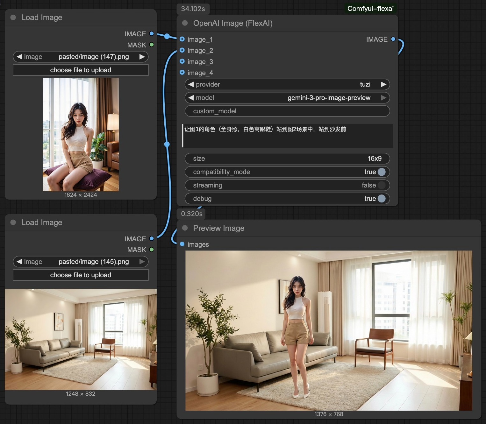
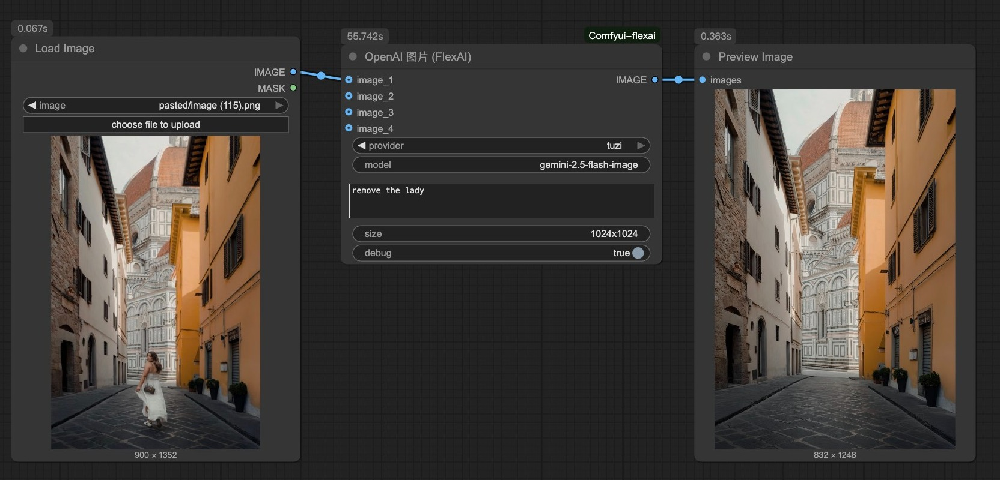
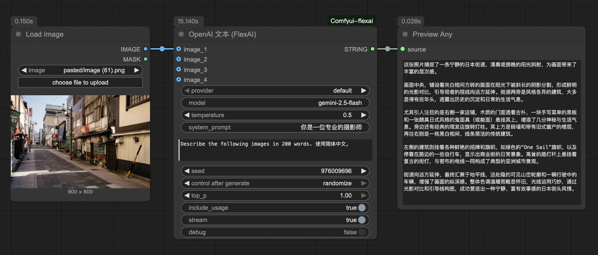
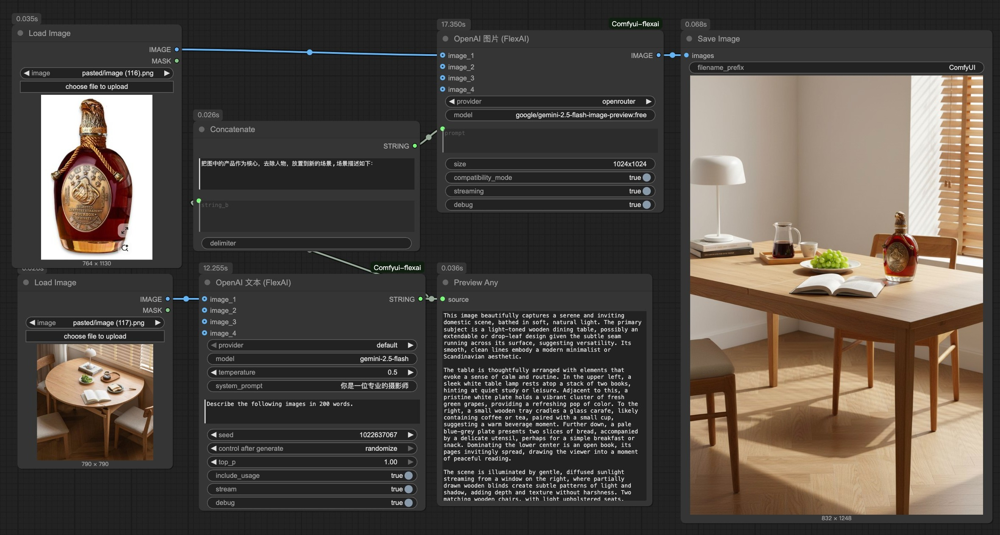
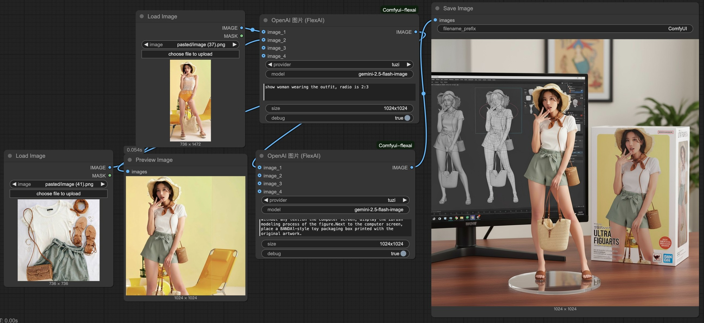

<!-- Bilingual Links -->
English | [中文 / Chinese](README-zh.md)

# ComfyUI FlexAI Plugin

[](https://github.com/Semonxue/Comfyui-flexai)
[](LICENSE)

A modern, unified ComfyUI plugin for OpenAI-compatible APIs with enhanced debugging, and multi-purpose text, image and video nodes.

I wrote this plugin mainly to simplify my own workflow, allowing access to LLM or image generation through standardized OpenAI interfaces. Recently, I've been mainly using this node to play with Gemini-2.5-Flash-Image generation (haven't tested the official Gemini interface, I'm connecting to an OpenAI-compatible endpoint), and the results are quite good.

## Recent Updates
- 2026-10-30 v1.3.0 **Full Seedance 2.0+ protocol support**: per-family rules (2.0 / 2.0 Fast / 2.0 Mini / 2.5) — resolution tiers and `SUPER_*` upscaling are validated per family and sent upper case; `duration` is clamped to the family range (2.0 series 4–15s, 2.5 4–30s); Seedance 2.5 automatically switches `ratio` to `adaptive` for first-frame / first-last-frame runs; new `output_format` (2.5 mp4/mov), `reference_video` (URL or `asset://`, single clip on 2.5 becomes `videoExtend`) and `reference_audio` (URL / `asset://` / mp3-wav data URI) inputs, so `content[]` can now mix image, video and audio references. Seedance 1.0/1.5 are no longer specifically targeted (they use the permissive legacy path).
- 2026-10-30 v1.2.0 **Multi-reference images (Seedance semantics)**: the node now has `image_2` / `image_3` / `image_4` slots plus `reference_mode`, and sends Seedance-style `content[]` items with explicit `role`s: 1 image → `imageToVideo` (role `first_frame`), first+last → `firstAndLastFrame` (`first_frame` / `last_frame`), 2+ images → `referToVideo` (all `reference_image`), with `refer_model` set accordingly. Reference images are never stretched to the output size (only first/last frames are pre-scaled), and oversized images are downscaled to Seedance's 6000px side limit. Single-image runs keep the `input_reference` / multipart compatibility fallbacks.
- 2026-10-30 v1.1.1 **Video geometry is now ratio + resolution, not pixels**: video models pick the pixel pair themselves (tu-zi / Volcengine Seedance request body is `{"resolution":"720p","ratio":"16:9","duration":8}`), so the old pixel `size` was ignored by the gateway and every run came back at the default size. The node now sends `ratio` (16:9/9:16/1:1/4:3/3:4/21:9/adaptive) + `resolution` (480p/720p/1080p/4k) + integer `duration` + `generate_audio` / `watermark`; `size` is only sent as a compatibility field when `custom_size` is filled in or a Sora-family model is used. Request bodies degrade through full flat params → uppercased resolution → Seedance-native `content[]` → minimal OpenAI body → multipart, and images try JSON `input_reference` (data URI) / `content[]` image item / multipart upload.
- 2026-10-30 v1.1.0 **New video node**: `flexai:openai_video` speaks the `/v1/videos` (Sora 2 style) protocol — text-to-video and first-frame image-to-video, async job polling, MP4 download, and a native ComfyUI `VIDEO` output (feeds `SaveVideo` / `Get Video Components`).<br>Also **removed stale models**: `dall-e-3`, `dall-e-2`, `gpt-4-turbo`, `gpt-3.5-turbo` are gone from defaults and the model list; image default is now the `gpt-image-2.5` family and text default is `gpt-4o`.<br>⚠️ OpenAI retired the hosted Videos API on 2026-09-24, so this node targets **OpenAI-compatible proxies** (new-api / tu-zi etc.).
- 2026-9-7 **Aspect Ratio Labels**: All size presets in the image node now include visual aspect ratio annotations, e.g. `1254x1254(1:1,1K)`, `1024x1536(2:3,1K)`, `1672x941(16:9,1K)`.
- 2025-11-21 v1.0.7 **New Models & Aspect Ratio Support**: Added support for models like `nano-banana` and `nano-banana-pro`, and allows using aspect ratios for size in non-compatibility mode.

- 2025-9-13 v1.0.6 The image node now supports JPG type for image URI content to be compatible with some seedream4 API requests.
- 2025-9-3 v1.0.5 **Model Memory & Management**: Added a persistent model list for both image and text nodes, with major code refactoring for maintainability.
- 2025-9-3 v1.0.4 **Multi-Image Return**: The image node can now process and output multiple images at once, resolving size mismatch and data type errors.
- 2025-9-3 v1.0.3 Fixed a bug in stream response handling and improved debug logging.
- 2025-9-3 v1.0.2 Added OpenRouter support (with streaming), debug info merged to debug.log
- 2025-9-2 v1.0.1 Optimized error messages in debug mode, added support for free models on OpenRouter
- 2025-9-2 v1.0 release, tested integration with [tuzi](https://api.tu-zi.com/) and [GB](https://github.com/snailyp/gemini-balance) works perfectly
- 2025-8-31 Plugin initialization

## ✨ Key Features

### 🌐 Multiple API Sources Support
- **Flexible Configuration**: Support multiple API providers via `.env` file, so if you have multiple token channels you don't have to switch back and forth, they can be shared.
- **Dynamic Selection**: Switch between providers without restarting ComfyUI
- **Model Memory & Management**: Select favorite models from a dropdown or add a new one in the `custom_model` field. **Run it once** to save it automatically for future use.

### 🖼️ OpenAI Image Node (`flexai:openai_image`)

**Dual-Mode Operation:**
- **Edit Mode**: Provide 1-4 images → Uses `images.edit` API, i.e., `/v1/images/edits` endpoint
- **Generate Mode**: No images → Uses `images.generate` API, i.e., `/v1/images/generations` endpoint

**Compatibility Mode**: Generate images via chat endpoint, compatible with OpenRouter and other third-party OpenAI-compatible interfaces, with streaming support, i.e., the standard `/v1/chat/completions` endpoint.

**Extended Model Support**:
- The interface now supports new models like `nano-banana` and `nano-banana-pro`.
- You can call them directly via the `custom_model` field. For instance, when using services like `api.tu-zi.com`, you can enter `gemini-3-pro-image-preview`.
- These models support both standard image generation and compatibility modes.

### 🎬 Seedance Video Node (`flexai:openai_video`)

Video generation for **Seedance 2.0 / 2.0 Fast / 2.0 Mini / 2.5** through an OpenAI-compatible gateway (`/v1/videos`, e.g. tu-zi / new-api). Returns a native **`VIDEO`** output, so clips feed `SaveVideo` or `Get Video Components` without ever being materialized as frame tensors.

**Five generation modes** (`reference_mode` picks the image role; `auto` infers it from how many images are connected):

| Mode | Inputs | `refer_model` sent | Roles in `content[]` |
|------|--------|--------------------|----------------------|
| Text-to-video | no image | `textToVideo` | — |
| Image-to-video (first frame) | 1 image | `imageToVideo` | `first_frame` |
| First + last frame | 2 images + `first_last_frame` | `firstAndLastFrame` | `first_frame` + `last_frame` |
| Multi-subject reference | 2–4 images | `referToVideo` | `reference_image` |
| Video extension (2.5 only) | a single `reference_video` | `videoExtend` | `reference_video` |

**Per-family protocol rules** (resolution tiers, duration range and special cases follow the model family):

| Family | `resolution` | `duration` | Notes |
|--------|--------------|------------|-------|
| Seedance 2.0 | `480P` `720P` `1080P` `4K` `SUPER_720P/1080P/4K` | 4–15s | `super_*` upscaling supported |
| Seedance 2.0 Fast / Mini | `480P` `720P` `SUPER_720P/1080P/4K` | 4–15s | native `1080P` / `4K` **not** available |
| Seedance 2.5 | `480P` `720P` `1080P` | 4–30s | first-frame runs switch to `ratio=adaptive`; `output_format` mp4/mov; video extension |

**Geometry model**: output size is not a pixel value — it is `resolution` (tier, shorter side = tier number) + `ratio` (aspect, incl. `adaptive`) + `duration` (integer seconds). Values are validated per family and sent upper case (`720P` / `SUPER_4K`), out-of-range durations are clamped, and the pixel `size` field only survives as a compatibility item for Sora-style channels (`custom_size` set, or the model name contains `sora`).

**Reference media**: `content[]` may mix images (up to 4) + video (`reference_video`, URL or `asset://`) + audio (`reference_audio`, URL / `asset://` / mp3-wav data URI); images carry `first_frame` / `last_frame` / `reference_image` roles. On 2.5, adaptive runs keep the first frame's own aspect instead of cropping it.

**Async job handling**: create → poll `GET /v1/videos/{id}` (`status`/`progress`) → read `video_url` or download `GET /v1/videos/{id}/content` → `VIDEO` output.

**Compatibility:**
- Body shapes are tried in order: full flat params → uppercased `resolution` variant → Seedance-native `content[]` → minimal OpenAI body → multipart (401/403/404/429 stop immediately);
- Reference images: `content[]` (preferred) → top-level `input_reference` (data URI) → multipart upload (single image only);
- Understands `{"code":0,"data":{...}}` wrappers and direct-URL proxies, and honours the server's `openai-poll-after-ms` hint;
- ⚠️ OpenAI retired the hosted Videos API on 2026-09-24, so this node targets **OpenAI-compatible proxy channels** (tu-zi / Volcengine Seedance family).

**Not supported yet**: Seedance 2.5 Draft (`draft` / `draft_task`), real-person asset upload + compliance (you can still paste an `asset://` id into the video/audio reference fields), `count>1` and `seed` (not exposed by the gateway's `/v1/videos`).

### 💬 OpenAI Text Node (`flexai:openai_text`)
**Multimodal Support:**
- **Text-Only Mode**: Standard text generation
- **Vision Mode**: Support image input for visual Q&A
- **Hybrid Mode**: Combined text and image analysis


**Multimodal Text Generation:**
- Pure text or vision-language understanding
- Support 1-4 reference images with auto-scaling
- Streaming and non-streaming modes
- **Debug Mode**: Complete JSON logging for all operations

## Quick Start

### Installation

1. Clone to ComfyUI custom nodes:
   ```bash
   cd ComfyUI/custom_nodes
   git clone https://github.com/Semonxue/Comfyui-flexai.git
   ```

2. Install dependencies:
   ```bash
   cd Comfyui-flexai
   pip install -r requirements.txt
   ```

3. Configure providers (see Configuration section)
4. Restart ComfyUI

## Configuration

Create a `.env` file in the plugin root directory, or copy and rename the `.env.example` file.

### Single Provider
```bash
OPENAI_API_KEY=your_openai_api_key_here
OPENAI_API_BASE=https://api.openai.com/v1  # Optional
```

### Multiple Providers (Recommended)
```bash
# Define provider list
OPENAI_PROVIDERS=openai,anthropic,custom

# OpenAI
OPENAI_API_KEY_openai=sk-your-openai-key
OPENAI_API_BASE_openai=https://api.openai.com/v1

# Anthropic (via OpenAI-compatible endpoint)
OPENAI_API_KEY_anthropic=sk-your-anthropic-key  
OPENAI_API_BASE_anthropic=https://api.anthropic.com/v1

# Custom endpoint
OPENAI_API_KEY_custom=your-custom-key
OPENAI_API_BASE_custom=https://your-api.example.com/v1
```

## Node Parameters

### Image Node (`flexai:openai_image`)

| Parameter | Type | Description |
|-----------|------|-------------|
| `provider` | Choice | API provider selection |
| `model` | Choice | Model name from `flexai_models.json` (e.g. `gpt-image-2.5`, `nano-banana-pro`) |
| `custom_model` | String | Override the model for this run; saved to the dropdown after one run |
| `prompt` | String | Generation/editing prompt |
| `image_1-4` | Image | Optional images (edit mode if any provided) |
| `size` | Choice/String | Output size preset with aspect ratio label (e.g. `1254x1254(1:1,1K)`, `1024x1536(2:3,1K)`, `1672x941(16:9,1K)`). The dropdown offers all common ratios across 1K/2K/4K tiers. Use `custom_size` for free-form input. <br><br> **Aspect Ratio Support**: For specific models like `nano-banana` and `nano-banana-pro` in **non-compatibility mode**, this field accepts aspect ratios. Supported ratios and their corresponding resolutions are:<br> `1x1` → `1024x1024` <br> `2x3` → `832x1248` <br> `3x2` → `1248x832` <br> `3x4` → `864x1184` <br> `4x3` → `1184x864` <br> `4x5` → `896x1152` <br> `5x4` → `1152x896` <br> `9x16` → `768x1344` <br> `16x9` → `1344x768` <br> `21x9` → `1536x672` |
| `compatibility_mode` | Boolean | **Compatibility Mode**: Enable chat endpoint for image generation, compatible with OpenRouter and other third-party services |
| `streaming` | Boolean | Enable streaming in compatibility mode |
| `debug` | Boolean | **Enable detailed debug logging** |

### Video Node (`flexai:openai_video`)

| Parameter | Type | Description |
|-----------|------|-------------|
| `provider` | Choice | API provider selection |
| `model` | Choice | Video model (any Seedance 2.x entry in the list is preferred by default; add others via `custom_model`) |
| `custom_model` | String | Override the model for this run; saved to the dropdown after one run |
| `prompt` | String | Video prompt (required, 1–32000 chars) |
| `image` / `image_2` / `image_3` / `image_4` | Image | Up to 4 reference slots, used as first frame / last frame / reference subject according to `reference_mode` (sent as `content[]` items, each with a `role`) |
| `reference_mode` | Choice | How multiple images are interpreted (default `auto`): `auto` — 1 image becomes the first frame (`imageToVideo`), 2+ become multi-subject references (`referToVideo`, role `reference_image`); `first_frame` — only slot 1, as first frame; `first_last_frame` — slot 1 = first frame, slot 2 = last frame (`firstAndLastFrame`); `reference` — every image is a reference subject |
| `ratio` | Choice | **Aspect ratio** (default `16:9`): `16:9`, `9:16`, `1:1`, `4:3`, `3:4`, `21:9`, `adaptive`. Sent as the `ratio` field; `adaptive` lets the model derive it from the reference image |
| `resolution` | Choice | **Resolution tier** (default `720p`), validated per model family and sent upper case (`720P`/`1080P`/`SUPER_720P`…): Seedance 2.0 → `480p`/`720p`/`1080p`/`4k` + `super_720p`/`super_1080p`/`super_4k`; 2.0 Fast/Mini → `480p`/`720p` + `super_*` only; 2.5 → `480p`/`720p`/`1080p`. Unsupported tiers raise an error listing the allowed values |
| `custom_size` | String | Only for legacy channels that require a pixel `size` (Sora-style), e.g. `1792x1024`; ratio/resolution are derived from it |
| `duration` | Integer | Clip length in seconds (default 8), sent as integer `duration` (plus string `seconds` for Sora-style channels). Out-of-range values are **clamped** per family: Seedance 2.0 series 4–15s, 2.5 4–30s; `sora-2` only 4/8/12 |
| `generate_audio` | Boolean | Sent as `generate_audio` (Seedance audio track), default True |
| `watermark` | Boolean | Sent as `watermark`, default False |
| `output_format` | Choice | Container format sent as `output_format` (**Seedance 2.5 only**): `auto` (default, omitted) / `mp4` / `mov`; setting it on the 2.0 series raises an error |
| `reference_video` | String | Reference video: an `https://…` URL or `asset://` id (data URIs are **not** supported for video). Used as `role=reference_video` on 2.0/2.5; a single clip on 2.5 becomes `videoExtend` with `ratio` forced to `adaptive` |
| `reference_audio` | String | Reference audio: `https://…`, `asset://` id, or `data:audio/mpeg;base64,…`, sent as `role=reference_audio` |
| `poll_interval` | Integer | Seconds between polls (default 5; shortened when the server sends `openai-poll-after-ms`) |
| `timeout` | Integer | Overall timeout in seconds (default 900); renders usually take 1–5 minutes |
| `debug` | Boolean | Log full request/response/poll details to `debug.log` |

**Output**: native `VIDEO` — pair with `SaveVideo` to write an mp4, or `Get Video Components` to split frames/audio.

### Text Node (`flexai:openai_text`)

| Parameter | Type | Description |
|-----------|------|-------------|
| `provider` | Choice | API provider selection |
| `model` | Choice | Model name (e.g. `gpt-4o`, `minimax-m3`) |
| `custom_model` | String | Override the model for this run; saved to the dropdown after one run |
| `system_prompt` | String | System message |
| `user_prompt` | String | User message |
| `image_1-4` | Image | Optional reference images |
| `temperature` | Float | Sampling temperature (0.0–2.0) |
| `top_p` | Float | Nucleus sampling |
| `seed` | Integer | Random seed (0 = not sent) |
| `stream` | Boolean | Enable streaming mode |
| `debug` | Boolean | **Enable detailed debug logging** |

---

## Example Workflows

### Product Placement

[Download Workflow](workflows/flexai-product-placement.json)

### Figure Redress

[Download Workflow](workflows/flexai-figure-redress.json)

---

Built with ❤️ for the ComfyUI community
